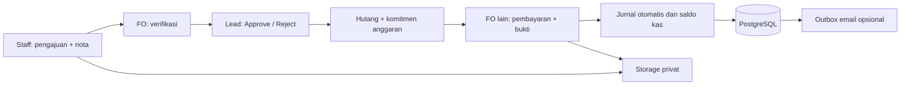
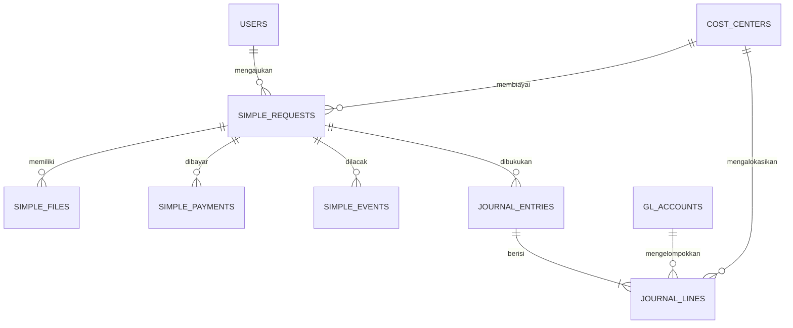
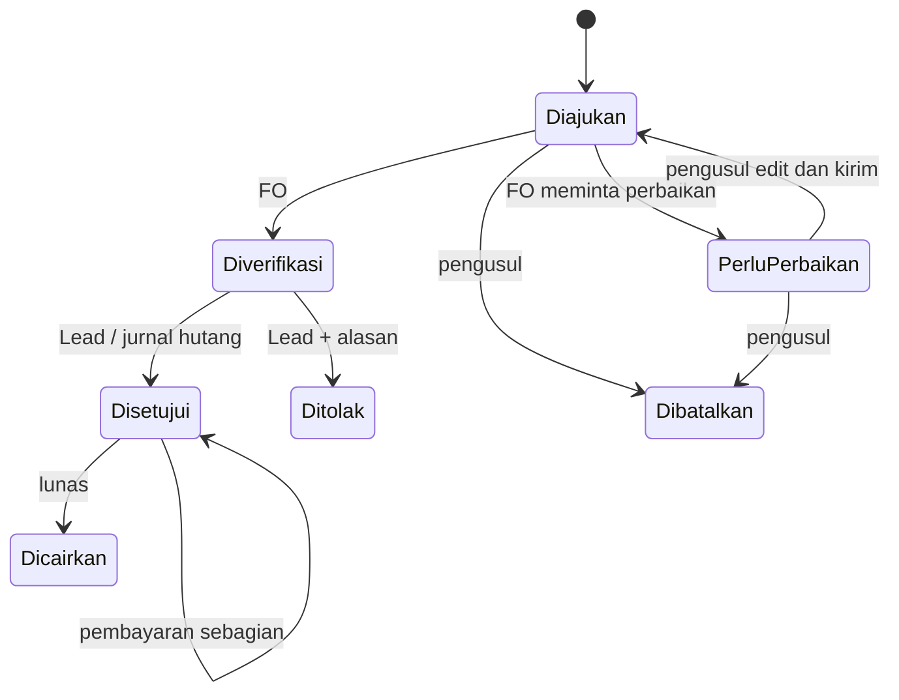

# Arsitektur versi sederhana

Next.js menyatukan UI dan server, PostgreSQL menyediakan transaksi atomik, FK, penguncian dan jurnal seimbang; Supabase Storage menyimpan dokumen privat dengan signed URL singkat setelah otorisasi. Modular monolith dipilih agar pembayaran, jurnal, audit dan outbox berada dalam satu transaksi. Skala 2.000 baris tidak membutuhkan microservices.

## Aturan inti

- Pengajuan minimal Rp10.000, nominal integer rupiah, maksimal Rp100 miliar per input. Pembelian tidak boleh bertanggal masa depan. Pengusul memilih divisinya sendiri; kategori akun ditetapkan FO.
- Dokumen wajib saat submit. Validasi format JPEG/PNG/WebP/PDF, foto minimal 400 piksel, PDF valid maksimal 50 halaman, hash nota identik lintas pengajuan ditolak. Tidak menggunakan OCR, verifikasi isi nota oleh manusia.
- Perbaikan dan edit hanya sebelum verifikasi. Penggantian nota menonaktifkan versi lama tanpa menghapusnya. Pembatalan juga hanya sebelum verifikasi dan mempertahankan riwayat.
- Identitas pengusul, FO verifikator, Lead dan FO pencair berbeda. Admin teknis bukan penyetuju. Semua otorisasi diperiksa ulang di server.
- Anggaran per cost center berlaku sepanjang Gen 8. Verifikasi dan persetujuan memeriksa sisa anggaran. Persetujuan mereservasi nominal dengan lock per cost center. Pengajuan disetujui dan dibayar dihitung sekali, bukan komitmen + pembayaran yang dijumlah dua kali.
- Dr beban/aset terpilih, Cr hutang pada persetujuan. Dr hutang, Cr kas pada pembayaran. Dr kas, Cr penerimaan pada dana masuk. Jurnal posted tidak diedit/dihapus.
- Deferred constraint trigger memeriksa minimal dua baris, jumlah debit = kredit pada commit; baris jurnal baru harus dibuat pada transaksi header yang sama. Header, baris, audit, dan pembayaran menolak update/delete/truncate. Pemilik PostgreSQL tetap mempunyai kewenangan administratif terpisah dari Admin aplikasi.
- Pembayaran memegang row lock pengajuan serta advisory lock kas. Nominal tidak boleh melebihi sisa tagihan/saldo. Pembayaran, bukti, jurnal, status dan audit commit bersama. Token unik per form dan bukti yang hanya bisa digunakan sekali mencegah double posting.
- Email disimpan melalui outbox `notifications` berprefiks `simple:` dan hanya dikirim jika SMTP tersedia. Worker baru tidak menjalankan eskalasi/sanksi/tenggat versi lama. Bukti pembayaran dilampirkan untuk email pembayaran. Jadwal gratis tidak memberi jaminan SLA.
- RLS diaktifkan untuk tabel aplikasi, akses anon/authenticated Supabase dicabut. Koneksi server PostgreSQL memakai TLS terverifikasi dan role pemilik tabel. Login tetap akun aplikasi.

## Migrasi dan batas cakupan

`lib/simple/schema.sql` dipasang dengan advisory transaction lock dan ditrace ke fungsi Vercel. `simple_versions` menandai cut-off saldo pembukaan. Tabel versi lama dipertahankan untuk arsip/kompatibilitas, tetapi mutasi web lama dihentikan. Saldo buku kas lama dicatat sebagai Dr/Cr kas lawan saldo awal, satu kali; bukan pernyataan saldo bank sudah diverifikasi. Data pengajuan lama tidak dibuatkan jurnal biaya/hutang ulang. Rekonsiliasi hutang/advance lama merupakan langkah cut-off yang harus ditinjau tim.

Versi ini sengaja tidak mencakup PO, inventaris, dana muka baru, urgent, splitting, sanksi, retur, nota hilang, AR sponsor, tutup buku multi-periode atau reversal mandiri. Koreksi jurnal setelah posting membutuhkan prosedur pembukuan terkontrol; tidak ada editor jurnal bebas. Rp1,8 miliar tidak diisi otomatis sebagai anggaran maupun saldo kas. CoA biaya/aset dan cost center dapat ditambah tanpa mengubah kode.

Setelah cut-off, trigger database juga menolak mutasi pada pengajuan, item, dokumen, pembayaran, dan buku kas versi lama. Dengan demikian deployment lama yang belum diperbarui tidak dapat melanjutkan pencairan di luar GL baru. Login dan pembacaan arsip tetap bekerja. Nota versi lama yang sudah dibayar tidak dapat digunakan sebagai nota pengajuan baru.
