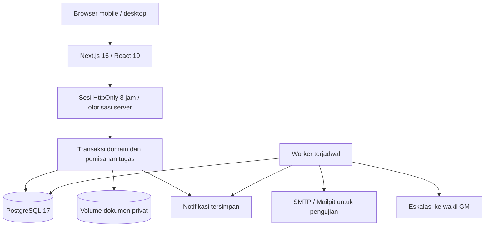
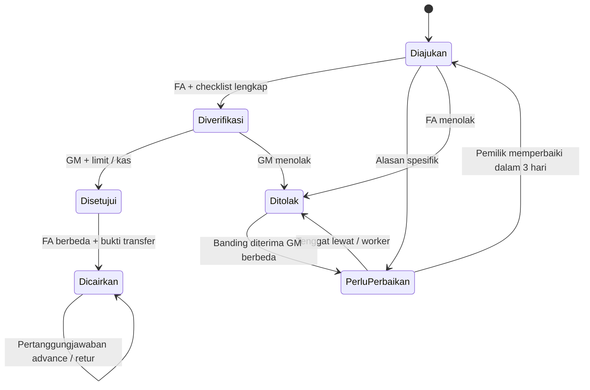
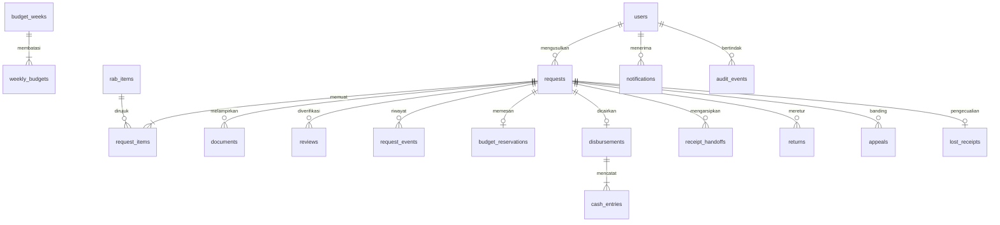

# Arsitektur dan kebijakan Anargya FAB

Bahasa antarmuka Indonesia; tampilan mobile dan desktop. Login database menggunakan username dan kata sandi (scrypt salted). Akun awal FAB dibuat sekali dari ADMIN_INITIAL_PASSWORD. Tidak menggunakan SSO ITS sesuai keputusan pengguna.

## Komponen

PostgreSQL dipilih untuk transaksi keuangan, constraint, penguncian dan audit. Next.js menyatukan antarmuka dan server; API dan server actions tetap memeriksa otorisasi. Dokumen disimpan pada volume persisten di luar direktori publik. Adaptor S3 dapat ditambahkan jika deployment memerlukan banyak instance; versi ini menggunakan satu instance web dan volume bersama web/worker.

## Keputusan yang diterapkan

- Alur FA → GM sesuai arahan pengguna; HOD memantau divisi dan menambah RAB/inventaris divisinya. Tabel `approval_policies` mendokumentasikan ketiga jalur dengan verifier FA dan approver GM. Tidak ada persetujuan HOD wajib.
- Empat tugas tetap berbeda orang: pengusul, FA verifikator, GM penyetuju, dan FA pencair. Pengguna belum mengizinkan pengecualian. Keterbatasan staf menahan transaksi, bukan melewati pemeriksaan.
- Semua nominal integer rupiah, minimum Rp10.000; 1–25 item RAB per pengajuan.
- Minggu Senin–Minggu WIB. Limit awal Mechanical Rp350.000, Electrical Rp350.000, Non-Technical Rp100.000; total reguler Rp800.000. Reservasi saat persetujuan final. Kebijakan dasar minggu baru dibekukan ketika minggu tersebut pertama dibuka.
- Carry-over maksimal 25% dasar divisi, hanya dari sisa dasar + realokasi minggu sebelumnya (carry lama tidak diteruskan), dan tidak menaikkan plafon total. GM dapat merealokasi sisa limit antar divisi. Realokasi tidak menciptakan dana.
- Lebih dari Rp800.000 atau akumulasi toko/tujuan sama dalam jendela tujuh hari masuk jalur langsung. Urgent selalu jalur urgent. Keduanya memerlukan FA → GM, catatan sumber dana dan kas mencukupi; tidak memakai amplop reguler mingguan.
- Pembelian duplikat dideteksi dari berkas identik, hash perseptual dan toko/tanggal/nominal. Berkas identik ditolak; kemiripan/tuple menjadi flag untuk FA. Sistem berbasis data terstruktur dan normalisasi, bukan OCR/pendeteksi fraud menyeluruh. Perubahan ejaan toko/tujuan dapat memerlukan pemeriksaan manusia.
- Bulan kalender digunakan untuk batas pengajuan. Tanggal akhir bulan dijepit ke tanggal valid bulan berikutnya. Perbaikan tiga hari kalender. Advance lima hari kalender sejak pencairan (dapat diatur 3–7). Urgent tiga jam, berlaku 24/7 (dapat diatur 2–4).
- Pencairan maksimum tujuh hari kalender setelah persetujuan, jadwal default Jumat. Pencair wajib mendahulukan batas SLA bila jadwal berikutnya terlambat. Sistem mencatat transfer yang dilakukan petugas; tidak mengakses rekening bank.
- Nota hilang default satu kasus per anggota per generasi; wajib pernyataan, mutasi dan persetujuan GM. Batas dapat dikonfigurasi, minimal satu. Retur mengembalikan kas setelah FA mengonfirmasi bukti dana kembali.
- Sanksi ditetapkan GM: peringatan → pembinaan → pembatasan berjangka. Peninjauan dan pencabutan melalui GM, dicatat audit. Tidak otomatis menuduh/menghukum dari flag duplikasi.
- Notifikasi dalam aplikasi selalu dicatat; email memerlukan SMTP. WhatsApp/Line opsional belum diintegrasikan.

## Status

Tidak ada draft tersimpan di versi ini: formulir baru belum dicatat sampai dikirim. Dokumen dapat dilengkapi setelah pengajuan dibuat. Versi bukti yang diganti dipertahankan untuk audit, dikeluarkan dari total nota aktif. Alasan perbaikan dokumen tercatat; perubahan nominal/item setelah kirim memerlukan pengajuan baru agar jejak keputusan tidak berubah.

## Entitas

Skema lengkap: `lib/schema.sql`; identitas dasar: `scripts/setup.mjs`.

Audit append-only dan buku kas dilindungi trigger. Ini melindungi dari aksi aplikasi dan SQL update/delete biasa, bukan dari pemilik database yang mengubah skema. WORM / log eksternal dengan retensi terkunci belum tersedia.

## Halaman

`/login`, `/` (dashboard per peran), `/requests`, `/requests/new`, `/requests/[id]`, `/catalog`, `/finance`, `/admin`, `/settings`, `/notifications`, `/help`, `/account`, `/audit`, `/handover`.

API dokumen selalu memeriksa sesi dan akses pengajuan; HOD tidak dapat membaca mutasi/bukti transfer anggota lain. Ekspor laporan dan serah terima hanya FA/GM/Admin. Ekspor data tidak menyertakan hash kata sandi atau sesi.
