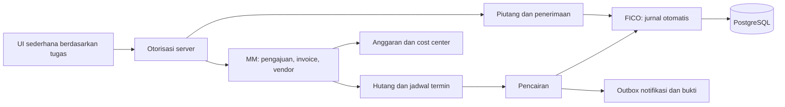
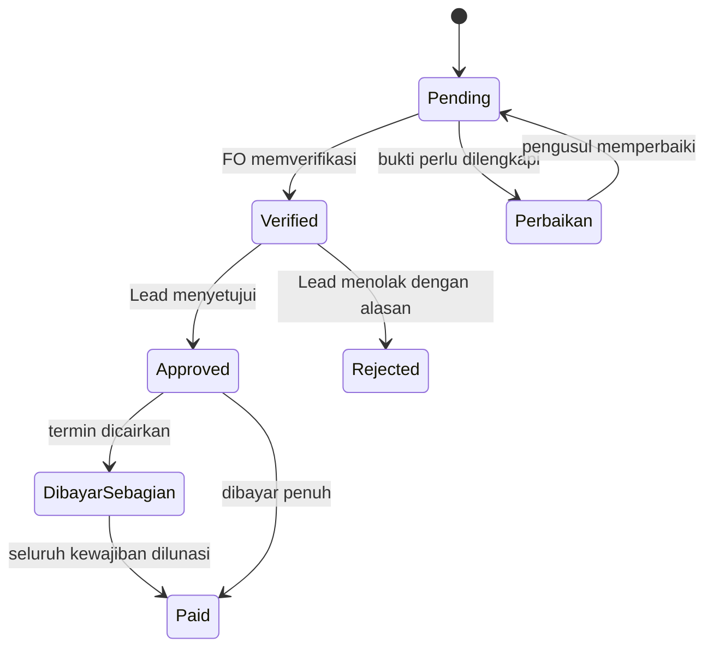
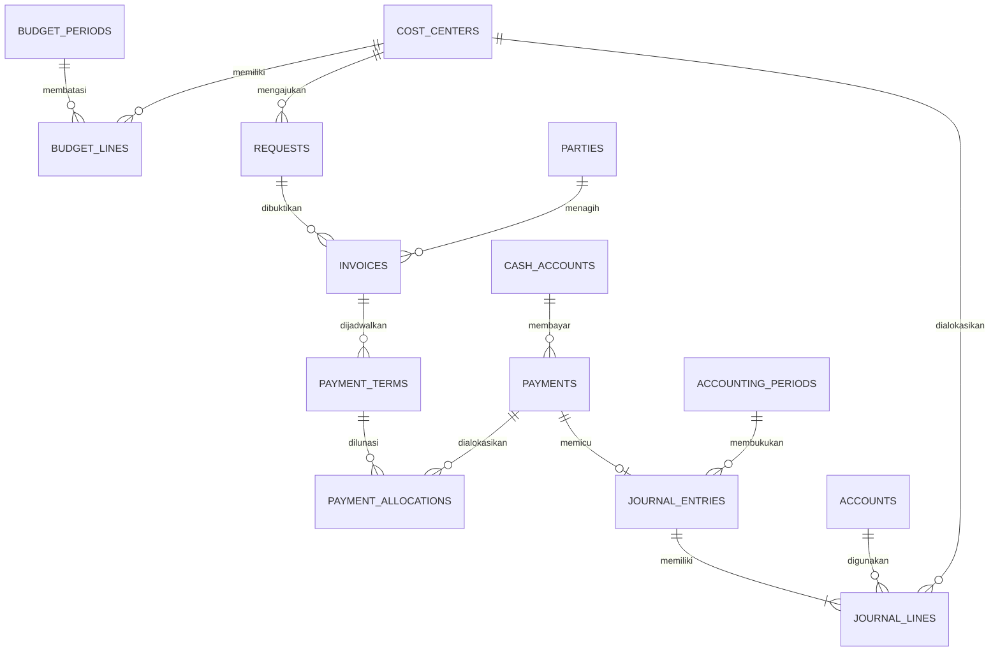

# Rancangan peningkatan FICO, MM, dan AP/AR

Status: rancangan untuk pembahasan, belum diimplementasikan atau dimigrasikan ke Supabase. Spesifikasi ini menggantikan pendekatan penyederhanaan tampilan saja. Keputusan waktu pengakuan jurnal, periode anggaran, nama cost center, dan pemisahan FO masih menunggu jawaban pemilik sistem.

## Evaluasi sistem yang tersedia

Aplikasi sudah memiliki pengajuan, upload bukti privat, FA → GM → pencairan, saldo kas append-only, batas mingguan, audit, laporan, edit pengajuan sebelum verifikasi dan pengelolaan akses anggota. Namun `cash_entries` merupakan buku kas satu sisi, bukan general ledger double-entry. Tiga kelompok divisi masih tertanam dalam schema dan validasi. `disbursements.request_id UNIQUE` hanya memungkinkan satu pembayaran per pengajuan; belum mendukung termin. CoA, cost center dinamis, hutang/piutang serta periode tutup buku belum tersedia. Sistem ini belum dapat disebut implementasi FICO/AP/AR.

Angka 2.000 transaksi dan Rp1,8 miliar berasal dari spesifikasi pengguna, belum divalidasi terhadap database produksi. Rp1,8 miliar adalah rencana/plafon, bukan saldo kas yang boleh diisikan otomatis.

## Arsitektur

Tetap Next.js + PostgreSQL/Supabase + private Storage. Gunakan modular monolith: satu aplikasi, satu transaksi database untuk pembayaran, jurnal, status, dan outbox. Pemisahan layanan belum diperlukan hanya karena 2.000 baris. Semua akses diperiksa di server, bukan hanya menyembunyikan tombol.

## Halaman dan operasi utama

| Menu | Operasi harian |
| --- | --- |
| Pengajuan saya | Buat, lihat, edit sebelum verifikasi; upload bukti; perbaiki dan ajukan ulang |
| Tugas verifikasi | FO melihat antrean Pending dan memeriksa bukti serta sisa anggaran |
| Persetujuan | Lead melihat antrean Verified; Approve / Reject dan catatan |
| Pembayaran | FO/pencair melihat Approved; pilih termin, rekening kas, nominal, bukti, lalu Dana Dicairkan |
| Hutang/piutang | Lihat jatuh tempo, sisa tagihan, pembayaran/penerimaan; telusuri dokumen sumber |
| Keuangan | Saldo per rekening, pemakaian anggaran, jurnal read-only, rekonsiliasi dan laporan |
| Pengaturan | Anggota, hak akses, cost center, anggaran, CoA, pemetaan otomatis, periode buku |

UI menampilkan nama Indonesia dengan padanan Pending/Diajukan, Verified/Diverifikasi, Approved/Disetujui. Tidak mengubah status database lama hanya untuk terjemahan. Tugas dibedakan dari daftar seluruh transaksi. Form tidak meminta pengguna memilih debit/kredit; pemetaan kategori ke akun dilakukan sekali oleh Lead. Bukti yang belum lengkap menghalangi verifikasi, bukan menghasilkan transaksi seolah sudah sah.

Detail pengajuan memuat status persetujuan dan status pembayaran terpisah. Ditolak bukan penghapusan histori. Pembatalan setelah posting memerlukan reversal yang sesuai dan pelepasan komitmen anggaran; tidak sekadar mengganti status.

## Skema relasional yang diusulkan

Tabel tambahan:
- `cost_centers`: kode unik, nama, kelompok lama (opsional), aktif. Referensi FK dari pengguna, RAB, pengajuan, anggaran, dan baris jurnal. Nonaktif menggantikan hapus jika sudah dirujuk.
- `budget_periods`, `budget_lines`, `budget_commitments`: plafon per periode/kategori/cost center, komitmen dan realisasi. Batas mingguan lama menjadi kebijakan tambahan yang dapat diaktifkan, bukan satu-satunya anggaran. Realokasi tercatat dan tidak menaikkan total plafon.
- `accounts`: kode unik, nama, tipe Asset/Liability/Equity/Income/Expense, aktif, akun induk; hanya akun posting yang menerima transaksi.
- `cash_accounts`: bank/kas, referensi akun GL, aktif. Saldo bersumber dari jurnal posted; buku kas lama ditautkan untuk kompatibilitas, tidak dijumlah dua kali.
- `account_mappings`: kategori dan jenis transaksi ke akun beban/aset, hutang, dana muka, pendapatan, kas. Aturan terversi dan dicatat pada transaksi. CoA contoh harus ditinjau, tidak semua komponen otomatis dianggap beban.
- `parties`: vendor/anggota/pelanggan dengan referensi akun anggota bila ada; data rekening tidak tampil ke peran yang tidak berwenang.
- `invoices`, `payment_terms`, `payments`, `payment_allocations`: tagihan, tanggal jatuh tempo, nominal termin, pembayaran aktual, dan alokasi. Jumlah pembayaran tidak boleh melebihi sisa hutang. Referensi unik sumber/idempotency mencegah klik ganda.
- `receivables`, `receipts`, `receipt_allocations`: piutang dan penerimaan. Contoh piutang sponsor memerlukan bukti dan persetujuan; jangan menganggap seluruh penerimaan kas sebagai piutang. Dana muka anggota dipisahkan sebagai aset, bukan beban final.
- `accounting_periods`: tanggal awal/akhir, open/closed, penutup dan waktu. Transaksi tertutup tidak diubah melalui CRUD umum.
- `journal_entries`: nomor unik, tanggal/periode, sumber transaksi, status posting, pembalik untuk jurnal sebelumnya, aktor dan waktu. Kunci unik sumber + jenis event mencegah posting berulang.
- `journal_lines`: akun, cost center bila relevan, debit/kredit integer rupiah, pihak; salah satu sisi positif dan sisi lain nol. Deferred constraint trigger memvalidasi minimal dua baris dan total debit = kredit saat commit. Posted journal append-only.

Indeks: foreign key dan antrean berdasarkan status/tanggal, cost center/periode, invoice jatuh tempo, pihak, serta sumber jurnal unik. Gunakan pagination server, hindari memuat semua dokumen/laporan ke halaman sekaligus.

## Aturan posting dan konsistensi

Pilihan basis akrual masih memerlukan keputusan pemilik. Contoh bila akrual disepakati:

| Event | Debit | Kredit |
| --- | --- | --- |
| Invoice/reimbursement disahkan untuk pembukuan | Beban/persediaan/aset sesuai kategori | Hutang vendor/anggota |
| Dana Dicairkan atas hutang | Hutang vendor/anggota | Bank/kas |
| Dana muka dibayar | Uang muka anggota | Bank/kas |
| Pertanggungjawaban dana muka disahkan | Beban/aset sesuai bukti | Uang muka anggota |
| Sisa dana muka dikembalikan | Bank/kas | Uang muka anggota |

Jika basis kas dipilih, pencairan reimbursement membukukan debit beban/aset dan kredit kas; AP operasional belum menjadi hutang GL. Jangan menggabungkan dua pola sehingga beban diakui dua kali. Pada akrual, transisi Approved harus memiliki dokumen lengkap sebelum pengakuan; pembatalan dan retur membalik sumber terkait.

Pencairan berjalan dalam satu transaksi: kunci kewajiban dan rekening, periksa hak/status/sisa kewajiban/saldo/periode, insert pembayaran + alokasi, insert jurnal seimbang, update status, append audit dan outbox, commit. Kegagalan salah satu langkah membatalkan semuanya. Tombol Dana Dicairkan mencatat transfer yang sudah dilakukan; integrasi bank otomatis belum termasuk.

Koreksi oleh Lead menggunakan reversal dan jurnal pengganti dengan alasan. Master CoA boleh diedit sesuai hak akses, tetapi jurnal posted tidak dapat dihapus atau diubah langsung, termasuk oleh Super Admin aplikasi. Akun yang sudah dipakai tidak dihapus. Hak akses PostgreSQL pemilik database merupakan batas administratif terpisah.

## Peran dan keputusan yang belum final

| Peran bisnis | Hak |
| --- | --- |
| Staff | Buat dan lihat milik sendiri, perbaiki/edit sebelum verifikasi; tidak membaca rekening pihak lain |
| FO | Lihat antrean, verifikasi, jadwal vendor, jurnal read-only; pencairan sesuai pemisahan tugas |
| Evaluator/Financial Lead | Approve/Reject, master CoA dan aturan akun, penutupan periode, reversal terkendali |
| Admin teknis | Akun/akses dan konfigurasi teknis; bukan otomatis pemberi persetujuan atau pemegang hak posting |

Migrasikan label FA → FO dan GM → Lead melalui pemetaan kompatibilitas, jangan mengganti role secara massal tanpa penetapan akun. HOD/deputy lama tetap berfungsi sampai hak baru diputuskan. Pengusul dan penyetuju wajib berbeda. Apakah FO verifikasi boleh sekaligus mencairkan masih menunggu keputusan; aturan empat orang yang berlaku tidak dilonggarkan otomatis. Staff CRUD terbatas: edit hanya sebelum verifikasi untuk mempertahankan fitur perbaikan yang baru diminta, tidak boleh mengedit transaksi setelah pembayaran.

## Migrasi dan tahapan implementasi

1. Cadangkan database dan Storage. Buat migrasi aditif/versioned, jalankan pada salinan staging. Buat master cost center, periode dan CoA setelah mapping disepakati. Jangan membuat 12 nama divisi fiktif.
2. Migrasikan tiga kelompok lama dengan tabel pemetaan; record yang belum terpetakan tetap dapat ditelusuri dan diblokir dari posting baru sampai diperbaiki. Tetapkan saldo awal per rekening berdasarkan rekonsiliasi dan tanggal cut-off, bukan plafon Rp1,8 miliar.
3. Implementasikan GL dengan constraint dan pengujian terlebih dahulu, lalu posting atomik pada pencairan serta pendapatan/retur/dana muka. Riwayat lama diimpor dengan kunci sumber; jangan posting ulang saldo yang sudah dibawa ke jurnal pembukaan.
4. Aktifkan hutang dan termin, kemudian AR, penutupan periode dan laporan keuangan. Dua ribu baris spreadsheet diimpor melalui preview, pemetaan kolom, validasi, batch ID dan rekonsiliasi total sebelum apply.
5. Uji perpindahan seluruh peran dan UI tugas sederhana di desktop/mobile; uji rollback, klik ganda, pencairan bersamaan, saldo tidak cukup, cost center salah, jurnal tidak seimbang, termin berlebih, periode tertutup, reversal dan pemulihan backup.

Kriteria penerimaan: setiap pembayaran memiliki tepat satu event jurnal posted yang seimbang; saldo GL kas cocok dengan mutasi pembayaran; komitmen + realisasi anggaran tidak dihitung ganda; total import cocok dengan sumber; tidak ada pengajuan/akun historis kehilangan referensi. Tidak ada klaim sistem ini setara dengan seluruh kemampuan SAP.
